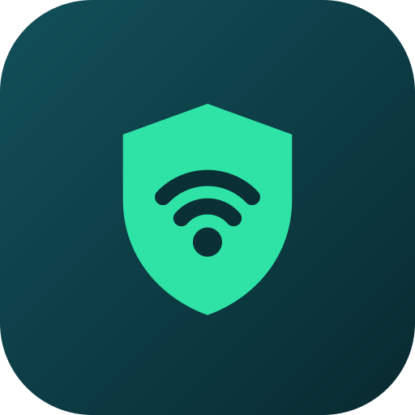

# Kombain для Windows

VPN-клиент для компьютера: VLESS Reality, XHTTP, Hysteria2, TUIC, AmneziaWG, импорт `vpn://` из Amnezia — и свой сервер в пару кликов.

## Скачать

Откройте вкладку **Releases** и скачайте `Kombain-…-windows-x64-setup.exe` (установщик) или `…-portable.zip` (без установки, просто распакуйте и запустите `Throne.exe`).

Нужна Windows 10 или 11, 64 бит.

## Что умеет

- **Свой сервер.** Кнопка «Мои серверы» → «Поднять сервер»: укажите IP вашего VPS (Debian или Ubuntu), логин и пароль SSH. Kombain сам поставит VLESS Reality, VLESS XHTTP, Hysteria2 и TUIC, создаст ключи и добавит профили отдельной группой. Свой домен не нужен.
- **Каскад.** Сервер в России → сервер за рубежом: ТСПУ видит только соединение внутри страны.
- **Управление серверами.** Проверка состояния и трафика, пользователи с QR-кодами для телефона, смена ключей и портов, удаление с сервера.
- **Все популярные протоколы.** VLESS, VMess, Trojan, Shadowsocks, Hysteria2, TUIC, WireGuard, AmneziaWG, подписки, ссылки и `vpn://`.
- **Режим TUN** (весь трафик компьютера) или системный прокси, маршрутизация, автоматический выбор сервера.
- **Тёмная и светлая темы Kombain.**

Пароли и ключи SSH хранятся на компьютере в зашифрованном виде (Windows DPAPI — расшифровать их может только ваша учётная запись).

## Сборка

Сборка идёт в GitHub Actions (`.github/workflows/kombain-windows.yml`) при каждом пуше в `main`. Готовые файлы лежат в артефактах запуска. Тег вида `v1.2.3` создаёт релиз с установщиком.

## Лицензия и авторы

Kombain — форк [Throne](https://github.com/throneproj/Throne) (бывший Nekoray), распространяется под лицензией GPL-3.0, см. `LICENSE`. Спасибо авторам Throne, sing-box и Xray. Исходный README Throne — в `README.throne.md`.
